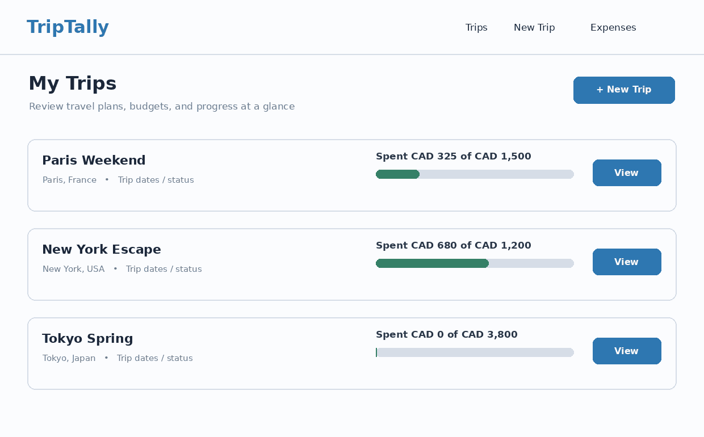
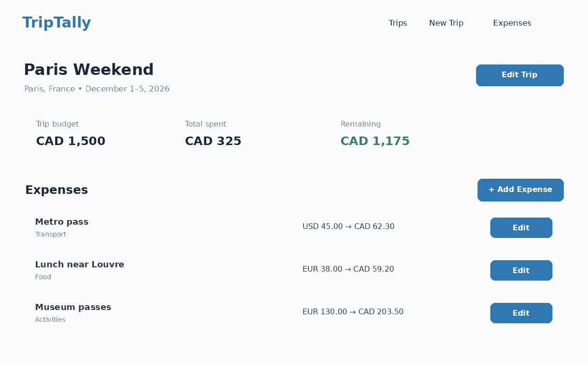
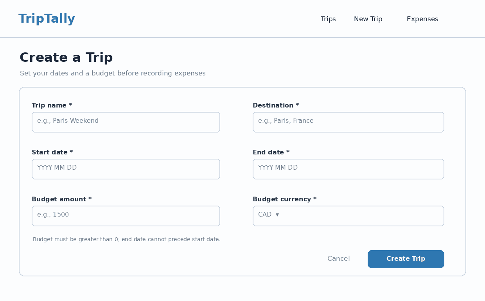
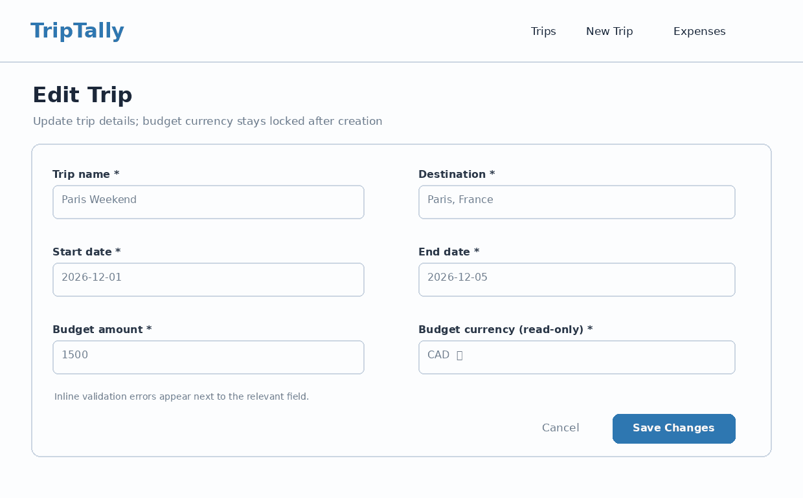

# TripTally — M1 Proposal and API Design

**Group number:** `14`  
**Members and GitHub usernames:** `[FILL IN]`  
**Public repository:** `https://github.com/michaelram1/cpan212-project-group-14`

## 1. Problem and users

Travelers often make purchases in multiple currencies while managing a single travel budget. A person might plan a trip in Canadian dollars but pay for restaurant meals in euros or transport in U.S. dollars. Notes and bank transaction lists show individual charges, but they do not easily answer whether a trip is staying within budget.

**TripTally** is a web app for students, solo travelers, and small-trip planners. Users create trips, enter their spending in the currency actually paid, and compare total converted expenses against the trip's original budget. It keeps user-owned trip/expense records inside the app; an external exchange-rate API supports the conversion feature rather than being the app's only data.

## 2. Features

### MVP (planned for M6)

1. A signed-in user can create a trip with a destination, dates, budget amount and budget currency.
2. A signed-in user can browse their trips and open a trip's budget and expense details.
3. A signed-in user can edit or delete a trip and its related expenses.
4. A signed-in user can create travel expenses with amount, original currency, category, date and notes.
5. A signed-in user can list, edit and delete individual expenses for a trip.
6. A signed-in user can preview an exchange-rate conversion using Frankfurter through the Express server and save an expense with a snapshot of the conversion.
7. A signed-in user can filter/sort/page through expenses and review spending by category.

### Later (outside this term)

- A signed-in user could upload and scan paper receipts.
- A signed-in user could share a trip with a friend.
- A signed-in user could export trip spending to CSV or PDF.

## 3. External API

**Name:** Frankfurter v2 exchange rates  
**Docs:** https://frankfurter.dev/  
**JavaScript docs:** https://frankfurter.dev/javascript/  
**Terms:** https://frankfurter.dev/license/  
**API key:** None required.  
**Rate limits:** Public access has no fixed daily or monthly quota, but anti-abuse limits apply; caching is encouraged.  
**App feature:** The expense create/edit page previews conversion into the trip's budget currency through our own Express `/api/rates` endpoint. The API also saves conversion snapshots when creating or changing an expense.

**Actual provider request to run and record:** `https://api.frankfurter.dev/v2/rate/usd/cad`

```bash
curl https://api.frankfurter.dev/v2/rate/usd/cad
```

**TODO before M1 submission:** Run the command and replace this note with the **real response returned**, trimmed to `date`, `base`, `quote` and `rate`. No live FX quote is fabricated in this draft. The format will look like:

```json
{
  "date": "[DATE RETURNED BY API]",
  "base": "USD",
  "quote": "CAD",
  "rate": "[NUMERIC RATE RETURNED BY API]"
}
```

Rates are **reference rates**, not real-time trading prices or guaranteed card settlement amounts. Expenses save both their original amount/currency and the server-calculated `convertedAmount`, `fxRate`, and `fxRateDate` used when saved.

## 4. Data model draft

M2 uses UUID string IDs and in-memory arrays. M4 moves to MongoDB ObjectIds, with the same user-visible attributes.

### Trip

| Field | Type | Required? |
|---|---|---|
| id | string UUID → ObjectId in M4 | Yes, generated |
| title | string (3–80 chars) | Yes |
| destination | string (2–80 chars) | Yes |
| startDate | date YYYY-MM-DD | Yes |
| endDate | date YYYY-MM-DD, not before startDate | Yes |
| budgetTotal | positive number | Yes |
| budgetCurrency | enum CAD, USD, EUR, GBP | Yes |
| notes | string (≤500 chars) | No |
| createdAt | date/time | Yes, generated |
| ownerId | User reference in M5 | Required from M5 |

A trip's budgetCurrency stays fixed after creation so saved expense conversions don't silently change meaning.

### Expense

| Field | Type | Required? |
|---|---|---|
| id | string UUID → ObjectId in M4 | Yes, generated |
| tripId | string UUID → Trip ObjectId ref in M4 | Yes |
| title | string (2–80 chars) | Yes |
| category | transport, lodging, food, activities, shopping or other | Yes |
| amountOriginal | positive number | Yes |
| originalCurrency | CAD, USD, EUR or GBP | Yes |
| spentOn | date YYYY-MM-DD | Yes |
| notes | string (≤300 chars) | No |
| convertedAmount | number | Yes, generated |
| fxRate | positive number | Yes, generated |
| fxRateDate | date string or null | Yes, generated |
| createdAt | date/time | Yes, generated |
| ownerId | User reference in M5 | Required from M5 |

### User (planned for M5)

| Field | Type | Required? |
|---|---|---|
| id | MongoDB ObjectId | Yes |
| displayName | string | Yes |
| email | unique string | Yes |
| passwordHash | bcryptjs hash, never exposed | Yes |
| createdAt | date/time | Yes |

**Relationships:** One User owns many Trips and Expenses; each Expense belongs to one Trip (`Expense.tripId` → `Trip._id`). The M4 detail endpoint will populate the linked Trip. Deleting a Trip deletes its related Expenses.

## 5. Endpoint list

The full CRUD endpoints below remain consistent from M2 to M3. M5 adds 401/403 on protected write routes.

| Method | Path | Purpose | Success | Error statuses |
|---|---|---|---|---|
| GET | `/api/trips` | List trips | 200 | 500 |
| GET | `/api/trips/:id` | Get trip | 200 | 404, 500 |
| POST | `/api/trips` | Create trip | 201 | 400, 500 |
| PATCH | `/api/trips/:id` | Update trip | 200 | 400, 404, 500 |
| DELETE | `/api/trips/:id` | Delete trip and its expenses | 204 | 404, 500 |
| GET | `/api/expenses?tripId=:id` | List trip expenses | 200 | 400, 404, 500 |
| GET | `/api/expenses/:id` | Get expense | 200 | 404, 500 |
| POST | `/api/expenses` | Create expense and save conversion | 201 | 400, 404, 502, 504 |
| PATCH | `/api/expenses/:id` | Update expense | 200 | 400, 404, 502, 504 |
| DELETE | `/api/expenses/:id` | Delete expense | 204 | 404, 500 |
| GET | `/api/rates?from=USD&to=CAD&amount=50` | Preview converted amount | 200 | 400, 502, 504 |

**Error contract:** `{"error":{"message":"Readable message","details":{"field":"reason"}}}`. All paths use `/api/`. List endpoints return `{ "items": [], "total": 0, "page": 1, "limit": 10, "totalPages": 0 }` (sample envelope; M2 returns limit sized to data, M4 introduces page/filter/sort handling).

## 6. Wireframes

All four files below are present in `docs/wireframes/` and embedded here. Example prices shown in sketches are just mock data, not live currency rates.

### A. Trips list page — `/trips`



### B. Trip detail page — `/trips/[id]`



### C. Create trip page — `/trips/new`



### D. Edit trip page — `/trips/[id]/edit`



## 7. Team roles

**TODO: Assign actual members** to API lead, frontend lead, database lead and repository/pull-request lead before M1 submission. It is intentionally not fabricated here. Members must contribute code in later milestones.

## 8. Repository setup

Public repository must be named `cpan212-project-group-14` using the actual Blackboard group number, with this structure:

```text
cpan212-project-group-14/
├── api/                   # Node 24 + Express 5 API
├── web/                   # Next.js 16 frontend
├── docs/
│   ├── proposal.md
│   └── wireframes/
│       ├── 01_trips_list.png
│       ├── 02_trip_detail.png
│       ├── 03_create_trip.png
│       └── 04_edit_trip.png
├── .gitignore
├── README.md
└── CONTRIBUTIONS.md
```

Root README needs real member names and GitHub usernames. `.gitignore` covers `.env` and `node_modules/`.

## 9. Contributions and submission

Each member must make their own Git commits. Fill the `M1` section of CONTRIBUTIONS.md with actual work and matching commits. In Blackboard, one person submits the public GitHub repository URL in the **M1 group dropbox**, **not** this Markdown file or a zip attachment. Follow instructor-approved extensions if applicable.
